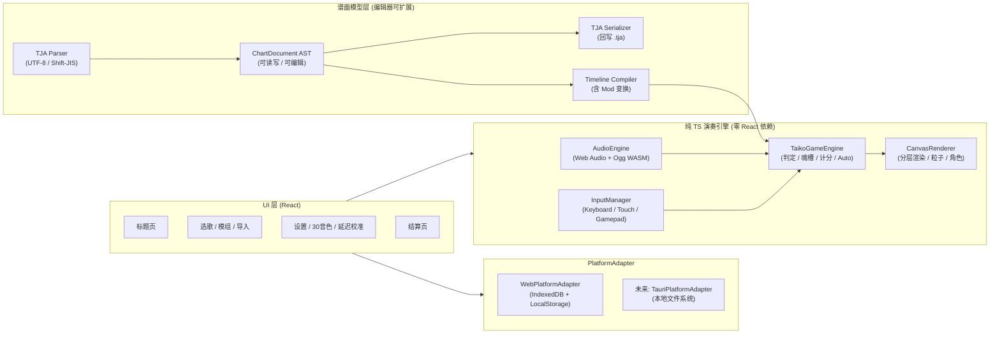

# Taiko Web 太鼓达人复刻项目技术方案（v1.0 可直接试玩版）

> 编制日期：2026-11-23  
> 目标：一口气交付可直接在线试玩的 Web 完整版并部署至生产环境，同时在数据结构与平台层预留桌面端打包、曲库扩展与未来谱面编辑器的合理扩展性。

---

## 1. 总体目标与范围

1. **直接可玩（One-Shot Playable Release）**：
   - 完整街机流程：标题页 → 选歌/难度/模组页（含预览试听与本地 `.tja` 拖拽导入） → Canvas 2D 高帧率演奏页 → 结算页（王冠/分数/统计） + 设置与延迟校准弹窗。
   - 内置 **3 首免版权/程序合成的高品质示范围曲目**（含多难度、大音符、连打、气球、Go-Go Time、变速），开箱即玩。
   - 支持用户直接拖拽或选择本地 `.tja` + 音频文件（`.ogg/.mp3/.wav`）游玩，并持久化保存到浏览器 IndexedDB。
2. **适度可扩展（不兜圈、不过度设计）**：
   - **Web 优先 → 桌面端可扩展**：通过 `PlatformAdapter` 接口隔离存储与曲库读写；Web 端实现 `IndexedDB + localStorage`，未来接入 **Tauri 2.0** 打包 macOS/Windows 安装包时仅需补充 `tauriPlatform.ts` 读取本地 `songs/` 目录。
   - **曲目易扩展**：内置曲库采用声明式清单 `public/songs/manifest.json` + 标准 `.tja` 目录结构，新增曲目只需添加文件夹与清单条目；用户自定义曲目支持 `.tja` 导入（并预留 `ChartFormatParser` 扩展点以便后续兼容 `.osu`）。
   - **预留谱面编辑器可行性（暂不做编辑器 UI）**：谱面解析产出结构化的 `ChartDocument` AST（保留小节、BPM、拍号、滚速、Go-Go、小节线等指令），与运行时编译的 `PlayableTimeline` 解耦，并提供双向 `serializeTja(doc)`，后续做可视化编辑器时可直接复用核心模型、音频时钟与 Canvas 渲染预览器。
3. **遵循 OpenClaw 开发与生产发布规范**：
   - Dev 环境：`rococo-oc-workplace:/work/oc-projects/taiko` → `oc-workspace/taiko`
   - Prod 环境：`rococo-root:/opt/docker/for-oc-dev2prod/taiko` → `oWinnieo/taiko` + Docker/Nginx 生产部署（`https://taiko.rococo.dev`）
   - 规范写入 `AGENTS.md` 与 `.agents/rules/openclaw-dev-prod-workflow.md`，并维护 `docs/progress/YYYY-MM-DD.md` 每日进度日志。

---

## 2. 技术栈选型与合理性

| 模块 | 选型 | 理由 |
| :--- | :--- | :--- |
| 构建与语言 | **Vite 6 + TypeScript 5 + React 19** | 极速开发构建、严格类型保障、React 专注 UI 页面与弹窗 |
| 游戏渲染引擎 | **原生 HTML5 Canvas 2D（纯 TS 模块）** | 与 React 渲染树完全隔离，60/120fps 稳定插值、Retina `devicePixelRatio` 清晰渲染、无 WebGL 上下文丢失风险 |
| 音频与主时钟 | **Web Audio API + WASM Ogg Vorbis 兜底解码** | `AudioContext.currentTime` 提供亚毫秒级音频时钟；预解码 `AudioBuffer` 零延迟触发鼓声；WASM 兜底解决 Safari / macOS WKWebView 不支持 `.ogg` 的顽疾 |
| 持久化（Web） | **IndexedDB + localStorage**（封装于 `PlatformAdapter`） | 零后端依赖即可保存用户导入的自定义曲包（音频二进制 + TJA 文本）、历史最高分、王冠与键位配置 |
| 单元测试 | **Vitest** | 针对 TJA 解析/序列化往返、谱面编译时间轴、判定窗口与计分规则做自动化验证 |
| 生产部署 | **Multi-stage Docker (`node:20-alpine` → `nginx:stable-alpine`)** | 纯静态构建产物，gzip/缓存策略完备，内存占用 <20MB，完美适配 `rococo-root` 容器与 HTTPS 反向代理 |

---

## 3. 素材清单与补齐策略

已从 `Better-taiko-web` 筛选并校验全部真实有效资源，去除 34 个全透明空 PNG、1 个空 GIF、1 个空 `vectors.json` 及 14 个静音音频后，共纳入 **194 个有效文件（9.5 MB）** 至 `public/assets/`：

- **鼓声（62 个）**：默认 `se_don.ogg` / `se_ka.ogg` + 30 套 `neiro_1..30` 咚/咔音色（支持设置页实时试听与切换）。
- **语音（63 个）**：标题、选歌、难度、开始、连打、50~5000 Combo 语音、全连、全良、结算语音。
- **有效音效（3 个）**：延迟校准节拍音 `se_calibration.ogg`、隐藏音、全良欢呼音。
- **贴图（64 个）**：音符/连打/判定圈/爆炸动画帧/气球、梅竹松鬼里鬼难度图标、11 个模组徽章、40 张舞台与流派背景、触控鼓面与按钮。
- **字体（2 个）**：`TnT.ttf`、`Kozuka.otf`。

**空缺素材补齐方案**：
- **太鼓本体、小咚角色（随 BPM 节拍律动 + Go-Go 狂欢 + 过关庆祝）、Go-Go 火焰、烟花、良/可/不可判定字**：采用 **Canvas 2D 程序化矢量绘制**，在高分屏下极致清晰且无版权隐患。
- **缺失的 UI 音效（菜单确认/取消/暂停/气球爆裂/通关/失败）**：内置轻量 **Web Audio 合成器**实时生成和风打击/提示音，零额外下载体积。
- **示例曲目（3 首）**：使用脚本生成 3 首带旋律、和弦、贝斯与鼓点的高质量免版权和风/节奏演示音频（`.wav`/`.mp3`），搭配手工编写的标准多难度 `.tja` 谱面。

---

## 4. 核心架构与数据流



### 关键技术细节
1. **TJA 规范支持**：
   - 头字段：`TITLE` / `SUBTITLE` / `BPM` / `WAVE` / `OFFSET` / `DEMOSTART` / `GENRE` / `COURSE` / `LEVEL` / `BALLOON` / `SCOREINIT` / `SCOREDIFF`。
   - 音符：`1`(咚)、`2`(咔)、`3`(大咚)、`4`(大咔)、`5`(小连打)、`6`(大连打)、`7`(气球)、`8`(结束)、`9`(地瓜/大球)。
   - 控制指令：`#START`、`#END`、`#BPMCHANGE`、`#MEASURE`、`#SCROLL`、`#DELAY`、`#GOGOSTART`、`#GOGOEND`、`#BARLINEON`、`#BARLINEOFF`。
   - 编码兼容：自动优先尝试严格 UTF-8 解码，失败时自动回退至 Shift-JIS / GBK，兼容社区常见日文/中文谱面。
2. **精准判定与计分（街机标准）**：
   - 良（Good）：`±25ms`（梅/竹适当放宽至 `±33ms`）
   - 可（OK）：`±75ms`（梅/竹 `±90ms`）
   - 不可（Bad）：`±108ms`（梅/竹 `±125ms`）
   - 大音符：单键命中得基础分，40ms 内双手同击触发大音符双倍加分与特效。
   - 魂槽：50 格进度，80%（40 格）达成 Clear 线，结算区分 失败 / 过关 / 银冠（全连）/ 金冠（全良）。
   - 真打计分：自动按全谱音符数与 Go-Go 权重计算基准分，全良满分趋近 1,000,000 分。
3. **输入与交互**：
   - 键盘默认：`D`(左咔)、`F`(左咚)、`J`(右咚)、`K`(右咔)，`Esc` 暂停，`F1` 切换 Auto，支持设置页自定义键位。
   - 触控/鼠标：底部可交互鼓面（内圈咚、外圈咔），桌面与移动端均可直接点击试玩。
   - 手柄（Gamepad API）：支持常见手柄与 TaTaCon 鼓控制器轮询。

---

## 5. 目录结构

```text
taiko/
├── AGENTS.md                         # 项目根规则（含 OpenClaw 规范）
├── .agents/rules/
│   └── openclaw-dev-prod-workflow.md # Antigravity 规则文件
├── docs/
│   ├── PLAN.md                       # 本技术方案文档
│   └── progress/
│       ├── README.md                 # 每日进度日志索引
│       └── 2026-11-23.md             # 每日进度日志
├── public/
│   ├── assets/                       # 194 个已校验素材 (audio/img/fonts)
│   └── songs/                        # 内置 3 首示范曲目 + manifest.json
├── scripts/
│   └── generate_demo_songs.py        # 免版权示范音频与谱面生成脚本
├── src/
│   ├── core/
│   │   ├── audio/                    # AudioEngine, OggDecoderFallback, SynthSfx
│   │   ├── chart/                    # types, tjaParser, tjaSerializer, compiler
│   │   ├── engine/                   # TaikoGameEngine, judge, scoring
│   │   ├── input/                    # InputManager (Keyboard/Gamepad)
│   │   └── renderer/                 # CanvasRenderer (舞台/小咚/轨道/音符/特效)
│   ├── platform/                     # PlatformAdapter + WebPlatformAdapter (IndexedDB)
│   ├── ui/                           # Title, SongSelect, PlayView, Result, SettingsModal
│   ├── App.tsx
│   ├── main.tsx
│   └── styles.css
├── deploy/
│   └── nginx.conf                    # 容器内 SPA + 静态资源缓存配置
├── Dockerfile
├── docker-compose.yml
├── package.json
├── tsconfig.json
└── vite.config.ts
```

---

## 6. 未来扩展路线预留

- **桌面客户端打包（Tauri 2.0）**：新增 `src-tauri/` + `src/platform/tauriPlatform.ts`，即可扫描本地 `songs/` 文件夹并打包为 macOS `.dmg` / Windows `.msi`。
- **可视化谱面编辑器**：复用 `ChartDocument` AST、`tjaSerializer`、`AudioEngine` 与 `CanvasRenderer` 预览轨道，新增编辑工具栏与时间轴画布即可。
- **多谱面格式与联机扩展**：在 `src/core/chart/` 新增 `osuParser.ts` 同样输出 `ChartDocument`；后续如有排行榜/双人对战需求可平滑接入后端 API / WebSocket。
